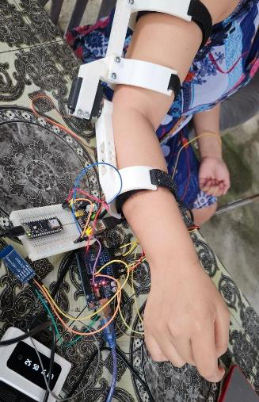
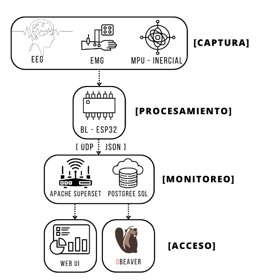
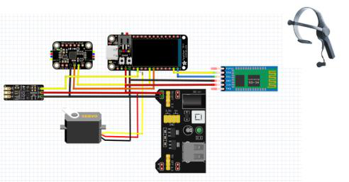

# NERO

Interfaz cerebro-computadora híbrida (EEG, EMG e inercial) que mueve un exoesqueleto de codo para neurorrehabilitación del miembro superior. Los datos se registran en tiempo real en PostgreSQL y se visualizan en Apache Superset.

Este repositorio acompaña el artículo *NERO: Una Interfaz Cerebro-Computadora Híbrida EEG-EMG-Inercial para la Neurorrehabilitación Asistida del Miembro Superior*, presentado en el VIII Congreso Internacional en Tecnología y Educación (TEDUCA 2026 / AmITIC), Universidad de Santander, Bucaramanga, Colombia.

<p align="center">
  
</p>

## Contenido

- [Cómo funciona](#cómo-funciona)
- [Configuraciones de firmware](#configuraciones-de-firmware)
- [Estructura del repositorio](#estructura-del-repositorio)
- [Hardware](#hardware)
- [Conexiones](#conexiones)
- [Instalación](#instalación)
- [Formato de los datos](#formato-de-los-datos)
- [Datos de las sesiones](#datos-de-las-sesiones)
- [Taller](#taller)
- [Estado del código y limitaciones](#estado-del-código-y-limitaciones)
- [Cómo citar](#cómo-citar)
- [Autores](#autores)
- [Licencia](#licencia)

## Cómo funciona

NERO combina tres señales para decidir si el usuario quiere flexionar o extender el codo:

| Señal | Sensor | Uso en el sistema |
|---|---|---|
| EEG | NeuroSky MindWave Mobile, por Bluetooth (protocolo ThinkGear) | El nivel de *attention* (0 a 100) habilita el movimiento |
| EMG | BioAmp EXG Pill, entrada analógica A0 a 500 Hz | Confirma que hay contracción muscular. Pasa por un filtro IIR de cuatro secciones de segundo orden |
| Inercial | MPU6050 por I²C (±2 g, ±250 °/s, filtro DLPF de 20 Hz) | La inclinación de la cabeza en el eje X indica la dirección: hacia un lado flexión, hacia el otro extensión |

El exoesqueleto se basa en la plataforma EduExo, impresa en 3D, y lo mueve un servomotor MG996R. Un microcontrolador con WiFi mueve el servo y envía cada lectura por UDP, en formato JSON, a un programa en la PC que la guarda en una base de datos.

<p align="center">
  
</p>

### Regla de decisión en el firmware

```
attention > 40  y  ángulo X < -7°  sostenido más de 1 s   ->  FLEXIÓN    (servo a 90°)
attention > 40  y  ángulo X > +7°  sostenido más de 1 s   ->  EXTENSIÓN  (servo a 180°)
cualquier otro caso                                       ->  REPOSO     (el servo se detiene donde está)
```

El servo avanza 1° por paso hasta llegar al ángulo objetivo. Si el estado cambia a mitad del recorrido, se detiene.

Los valores de arriba son los que tiene el código publicado. No son universales: los umbrales se calibran para cada persona en una sesión de unos 15 minutos y luego se escriben en el sketch antes de cargarlo. El artículo describe los criterios de esa calibración: atención ≥ μ + 1,5σ, RMS del EMG ≥ 0,15 · RMS de la contracción voluntaria máxima e inclinación de ±15°.

Las constantes que hay que ajustar son el `40` de *attention* y el `7` del ángulo en `firmware/NERO` o `firmware/NERO_V2`, y el `-220` del EMG en `firmware/NanoRP_SuperSet`.

## Configuraciones de firmware

El firmware está dividido en dos placas: un Arduino lee la diadema y el IMU, y una placa con WiFi mueve el servo y envía la telemetría. Hay dos combinaciones, y cada sketch del Arduino solo funciona con su pareja porque el campo después de `/` cambia de significado.

| | Configuración A | Configuración B |
|---|---|---|
| Arduino (EEG + IMU) | `firmware/NERO` | `firmware/NERO_V2` |
| Placa WiFi (servo + UDP) | `firmware/Lily_SuperSet` (ESP32) | `firmware/NanoRP_SuperSet` (Arduino Nano RP2040 Connect) |
| Quién decide el estado | El Arduino, y envía `0`, `1` o `2` | El Nano RP2040, con el ángulo que le envía el Arduino |
| EMG | Leído en el Arduino, sin efecto en la decisión (la condición está comentada) | Leído en el Nano RP2040 (A0). Es obligatorio que la señal filtrada baje de −220 |
| Paso del servo | 1° cada 50 ms | 1° por cada trama recibida del Arduino |
| JSON enviado | Bandas, attention, meditation, focusRatio, signalQuality | Lo mismo, más `status`, `servoPos` y `dataValid` |

La configuración B es la única en la que intervienen las tres señales. Si el ESP32 de la configuración A no recibe datos por serial, envía valores aleatorios para probar la red, y el puente los guarda igual que los reales. Revisa la consola del ESP32: indica `REAL` o `SIMULADO` en cada envío.

## Estructura del repositorio

```
NERO/
├── firmware/
│   ├── NERO/               Arduino, configuración A: EEG + IMU + máquina de estados
│   ├── NERO_V2/            Arduino, configuración B: EEG + IMU, envía el ángulo X
│   ├── Lily_SuperSet/      ESP32, configuración A: servo + UDP
│   ├── NanoRP_SuperSet/    Nano RP2040 Connect, configuración B: EMG + decisión + servo + UDP
│   ├── sketch_jul29b/      Versión anterior de Lily_SuperSet (envía al puerto 8888)
│   └── sketch_nov08a/      Prueba de conexión WiFi del Nano RP2040 Connect
├── superset_docker/
│   ├── docker-compose.yml  PostgreSQL 13 + Apache Superset
│   ├── superset_config.py  Configuración de Superset (caché de 1 s)
│   ├── schema.sql          Tablas eeg_data y datos_sensor
│   ├── upd_bridge.py       Recibe el UDP y guarda en SQLite
│   └── .env.example        Plantilla de credenciales
├── notebooks/
│   └── Taller_NERO_IEEE_EMBS_UTP.ipynb
├── prototipos_eeg_emg_imu/ Pruebas anteriores por sensor y envío a InfluxDB/Grafana
└── docs/img/               Figuras del artículo
```

## Hardware

- Arduino Uno o Nano
- ESP32 (LilyGO) para la configuración A, o Arduino Nano RP2040 Connect para la B
- Diadema NeuroSky MindWave Mobile y módulo Bluetooth HC-05 configurado como maestro, emparejado con la diadema, a 57 600 baudios
- BioAmp EXG Pill con electrodos de superficie Ag/AgCl
- MPU6050
- Servomotor MG996R con fuente externa de 5 a 6 V
- Estructura EduExo impresa en 3D

El artículo estima el costo total en menos de 500 USD.

## Conexiones

<p align="center">
  
</p>

| Desde | Hacia | Notas |
|---|---|---|
| HC-05 TX | Arduino D11 | `SoftwareSerial BT(11, 10)`: D11 es RX y D10 es TX |
| HC-05 RX | Arduino D10 | El HC-05 trabaja a 3,3 V en RX: usa un divisor de tensión |
| MPU6050 SDA / SCL | Arduino A4 / A5 | |
| BioAmp OUT | A0 del Arduino (config. A) o del Nano RP2040 (config. B) | |
| Arduino TX (D1) | RX de `Serial` en el ESP32 (A) o RX de `Serial1` (D0) en el Nano RP2040 (B) | 57 600 baudios. El ESP32 y el RP2040 trabajan a 3,3 V: usa un divisor de tensión |
| Señal del servo | Pin 2 de la placa WiFi | |
| GND | Todas las placas, la fuente del servo y los sensores | Tierra común |

No alimentes el MG996R desde el pin de 5 V del Arduino. Sus picos de corriente reinician la placa.

## Instalación

### 1. Firmware

Instala estas bibliotecas desde el gestor de bibliotecas del Arduino IDE:

- `I2Cdev` y `MPU6050` (Jeff Rowberg, i2cdevlib)
- `Servo` para el Nano RP2040. En el ESP32, una biblioteca que incluya `Servo.h`, por ejemplo ServoESP32
- `WiFiNINA` para el Nano RP2040 Connect
- `InfluxDbClient`, solo si vas a usar los prototipos con Grafana

Pasos:

1. Elige la configuración A o B y carga el sketch del Arduino que le corresponde.
2. En la carpeta del sketch de la placa WiFi, copia `secrets.example.h` como `secrets.h` y escribe el nombre y la contraseña de tu red. `secrets.h` está en `.gitignore`.
3. En el `.ino` de la placa WiFi, cambia `host` por la IP de la PC que va a recibir los datos. El puerto es `8088`.
4. Carga el sketch en la placa WiFi.

Mientras el Arduino esté conectado por cable a la placa WiFi, desconecta ese cable para subirle un sketch.

### 2. Base de datos y Superset

Necesitas Docker Desktop.

```bash
cd superset_docker
cp .env.example .env      # edita .env y cambia todas las contraseñas
docker compose up -d
```

Superset queda en <http://localhost:8088>. El usuario es `admin` y la contraseña es el valor de `SUPERSET_ADMIN_PASSWORD` en `.env`.

Crea las tablas:

```bash
docker exec -i project-nero-postgres sh -c 'psql -U "$POSTGRES_USER" -d superset' < superset_docker/schema.sql
```

Para el dashboard, agrega en Superset una conexión a la base `superset` del servicio `postgres` y crea un dataset sobre la tabla `eeg_data`. El dashboard original tenía nueve gráficos: un indicador por banda (theta, alpha, delta, beta y gamma), uno para attention, otro para meditation y dos series de tiempo.

### 3. Puente UDP

Necesitas Python 3.9 o superior. El puente solo usa la biblioteca estándar.

En `superset_docker/upd_bridge.py`, cambia `UDP_HOST` por la IP de tu PC (o `0.0.0.0` para escuchar en todas las interfaces) y `DB_PATH` por la ruta donde quieres el archivo SQLite. Luego:

```bash
python superset_docker/upd_bridge.py
```

El puente escucha UDP en el puerto 8088. Superset usa el 8088 de TCP, así que pueden correr al mismo tiempo. Cada 30 segundos imprime cuántas filas lleva guardadas.

## Formato de los datos

### Trama serial (Arduino → placa WiFi)

Una línea cada 100 ms, terminada en `;`:

```
&attention?meditation#focusRatio$delta%theta!alpha@beta*signalQuality/X;
```

- Configuración A: `X` es el estado (`0` reposo, `1` flexión, `2` extensión) seguido de `^` y el valor del EMG filtrado. El ESP32 ignora la parte del EMG.
- Configuración B: `X` es el ángulo de inclinación en el eje X, en grados.

`delta`, `theta`, `alpha` y `beta` llegan escalados a 0–100. `alpha` es la suma de *low* y *high alpha*, y `beta` la suma de *low* y *high beta*. `focusRatio` es `highBeta / (theta + delta) · 10`, limitado a 0–100. `signalQuality` es `100 − poorSignal`.

### Mensaje UDP (placa WiFi → PC)

Cada 500 ms. Ejemplo de la configuración B:

```json
{"theta": 34, "alpha": 21, "delta": 58, "beta": 12, "attention": 61, "meditation": 47,
 "focusRatio": 3, "signalQuality": 100, "status": -9, "servoPos": 104, "dataValid": true}
```

En la configuración B, `status` lleva el ángulo X recibido del Arduino, no el estado del brazo.

### Tabla `neural_readings` (SQLite, la crea `upd_bridge.py`)

| Columna | Tipo | Descripción |
|---|---|---|
| id | INTEGER PK | Autoincremental |
| timestamp | TEXT | Fecha y hora de la PC |
| unix_timestamp | INTEGER | Marca de tiempo Unix |
| device_id | TEXT | Siempre `ESP32_PROJECT_NERO` |
| theta, alpha, delta, beta | INTEGER | Bandas EEG (0–100) |
| attention, meditation | INTEGER | eSense (0–100) |
| focus_ratio | INTEGER | Ver arriba |
| signal_quality | INTEGER | Ver arriba |
| stress_level | INTEGER | `beta / 10`, limitado a 1–10 |
| heart_rate | INTEGER | `65 + 3 · stress_level`. Es un valor calculado, no una medición |
| session_id | TEXT | Bloques de 5 minutos |

### Tabla `eeg_data` (PostgreSQL, la lee Superset)

| Columna | Tipo | Descripción |
|---|---|---|
| id | SERIAL PK | Autoincremental |
| theta, alpha, delta, beta, gamma | INTEGER | Bandas EEG |
| attention, meditation | INTEGER | eSense (0–100) |
| timestamp | TIMESTAMP | Hora de inserción |

## Datos de las sesiones

Las lecturas EEG, EMG e inerciales de las sesiones con participantes no se publican en este repositorio. Son datos personales y se conservan para uso interno del proyecto. El repositorio incluye el esquema de las tablas (`superset_docker/schema.sql`), así que puedes generar tus propios datos con el mismo formato.

## Taller

[`notebooks/Taller_NERO_IEEE_EMBS_UTP.ipynb`](notebooks/Taller_NERO_IEEE_EMBS_UTP.ipynb) es el material del taller de IEEE EMBS en la Universidad Tecnológica de Panamá. Simula señales EMG, ECG y EEG con NeuroKit2, recorre el procesamiento de EMG (filtro pasa-banda, rectificación, envolvente RMS y umbral), arma un clasificador de reposo y contracción, y termina moviendo un servo en un Arduino Uno desde Python con PySerial. Las secciones 1 a 4 corren en Google Colab sin hardware.

```bash
pip install neurokit2 pyserial matplotlib numpy scipy
```

El taller usa un clasificador propio con fines didácticos. No es el mismo algoritmo del firmware.

## Estado del código y limitaciones

Este es código de prototipo de investigación, publicado tal como se usó en las pruebas.

- **Puente a PostgreSQL.** `upd_bridge.py` guarda en SQLite. El programa que llenaba la tabla `eeg_data` de PostgreSQL durante las sesiones no se conservó. Para ver datos en vivo en Superset, cambia el `INSERT` del puente a PostgreSQL (por ejemplo con `psycopg2`) o conecta Superset al archivo SQLite.
- **EMG en `firmware/NERO`.** El sketch lee el EMG una sola vez antes de entrar al ciclo que espera paquetes de la diadema, así que el valor enviado después de `^` no cambia. En la configuración B el EMG se lee de forma continua en el Nano RP2040.
- **Mensajes de depuración.** `firmware/NERO` imprime líneas de depuración por el mismo puerto serial que usa para hablar con el ESP32. El ESP32 las descarta con el mensaje `Error en formato de datos`. `NERO_V2` las tiene desactivadas.
- **Gamma.** El firmware no envía gamma, así que la columna `gamma` de `eeg_data` queda vacía o en 0.
- **Validación.** Las pruebas fueron una validación técnica con una participante durante 45 minutos. No es un ensayo clínico y NERO no es un dispositivo médico certificado.

## Cómo citar

```bibtex
@inproceedings{tello2026nero,
  author    = {Tello O., Rances J. and Mendieta C., Emely G. and P{\'e}rez, Luiyiana},
  title     = {{NERO}: Una Interfaz Cerebro-Computadora H{\'i}brida {EEG-EMG}-Inercial
               para la Neurorrehabilitaci{\'o}n Asistida del Miembro Superior},
  booktitle = {VIII Congreso Internacional en Tecnolog{\'i}a y Educaci{\'o}n (TEDUCA 2026 / AmITIC)},
  address   = {Bucaramanga, Colombia},
  publisher = {IEEE},
  isbn      = {979-8-3195-2019-7},
  year      = {2026}
}
```

GitHub también ofrece la cita en formato APA y BibTeX desde el botón **Cite this repository**, que lee [`CITATION.cff`](CITATION.cff).

## Autores

Facultad de Ingeniería en Sistemas Computacionales, Universidad Tecnológica de Panamá, Centro Regional de Azuero, Los Santos, Panamá.

- Rances J. Tello O. ([ORCID 0009-0005-2849-8562](https://orcid.org/0009-0005-2849-8562)), rances.tello@ieee.org
- Emely G. Mendieta C. ([ORCID 0009-0001-9384-5330](https://orcid.org/0009-0001-9384-5330))
- Luiyiana Pérez

## Licencia

El código está bajo la licencia MIT ([`LICENSE`](LICENSE)). Las figuras de [`docs/img/`](docs/img/) están bajo [CC BY 4.0](https://creativecommons.org/licenses/by/4.0/deed.es): puedes usarlas y modificarlas citando este trabajo.

Las piezas de la estructura mecánica pertenecen al proyecto EduExo y se rigen por su propia licencia.
